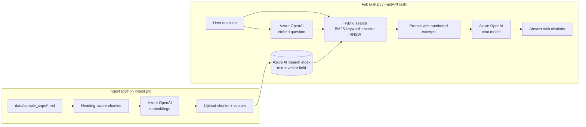

# Restaurant Policy RAG Chatbot


Ask questions about restaurant policies in plain English and get short answers **with citations** to the exact policy section. Built with **Python**, **Azure OpenAI** (chat + embeddings) and **Azure AI Search** (hybrid keyword + vector retrieval).

> Example: *"Can I swap my close shift with a new starter?"* → "No. A close shift can only be swapped with someone who is close-trained, and a shift manager must approve the swap [1]."

## Why I built this

I spent about four years as a Business Manager in high-volume restaurants (Grill'd and Mad Mex), leading teams of 15+. Crew ask the same policy questions every shift: who can close, what temperature the cool room should be, how shift swaps work. The answers sit in long SOP documents nobody reads mid-service. This project is a small retrieval-augmented generation (RAG) assistant that answers from those documents and shows where each answer came from, so managers can trust it.

## Architecture



**How it works**

1. **Chunk:** each markdown file is split on headings, then long sections are windowed (~800 characters, 120 overlap) so every chunk keeps its section title.
2. **Embed and index:** chunks are embedded with an Azure OpenAI embedding deployment and uploaded to an Azure AI Search index that has both searchable text fields and a vector field (HNSW).
3. **Retrieve:** a question runs as a **hybrid query** (keyword + vector) and Azure AI Search fuses the results with Reciprocal Rank Fusion.
4. **Answer:** the top excerpts are numbered and passed to the chat model with a strict system prompt: answer only from the excerpts, cite with `[n]`, and say so if the answer isn't there.

## Project structure

```
rag-policy-chatbot/
├── ragbot/
│   ├── config.py      # settings from .env
│   ├── chunking.py    # heading-aware markdown chunker (no Azure needed)
│   ├── clients.py     # Azure OpenAI + Azure AI Search clients, embed()
│   ├── index.py       # index schema with vector search profile
│   └── rag.py         # hybrid retrieval + grounded answer with citations
├── data/sample_sops/  # SAMPLE policy documents (fictional, for demo only)
├── tests/             # offline tests (chunker + RAG flow with fake clients)
├── ingest.py          # chunk -> embed -> upload
├── ask.py             # command-line Q&A
├── api.py             # FastAPI endpoint: POST /ask
├── requirements.txt
└── .env.example       # copy to .env, never commit secrets
```

## Prerequisites

- Python 3.10+
- An Azure subscription with:
  - **Azure OpenAI** (or a Microsoft Foundry project) with two model deployments: a chat model (e.g. `gpt-4o-mini`) and an embedding model (e.g. `text-embedding-3-small`)
  - **Azure AI Search** (the Free tier is enough for this demo)

## Setup

```bash
git clone https://github.com/sivakowshik/rag-policy-chatbot.git
cd rag-policy-chatbot
python3 -m venv .venv
source .venv/bin/activate        # Windows: .venv\Scripts\activate
pip install -r requirements.txt
cp .env.example .env             # then fill in your endpoints, keys and deployment names
```

## Usage

**1. Ingest the sample documents** (creates the index if it doesn't exist):

```bash
python ingest.py
# or point at your own folder of .md files
python ingest.py --docs path/to/your/docs
```

**2. Ask from the command line:**

```bash
python ask.py "Who is allowed to close the store?"
python ask.py          # interactive mode
```

**3. Or run the API:**

```bash
uvicorn api:app --reload
```

Open http://127.0.0.1:8000/docs and try `POST /ask`:

```bash
curl -X POST http://127.0.0.1:8000/ask \
  -H "Content-Type: application/json" \
  -d '{"question": "What temperature should the cool room be?"}'
```

Response shape:

```json
{
  "answer": "Keep cold food at 5°C or below ... [1]",
  "sources": [{ "number": 1, "source": "food-safety.md", "title": "Temperatures" }]
}
```

## Tests

The tests run offline. They cover the chunker and the retrieve → prompt → answer flow using fake Azure clients, so no keys are needed:

```bash
pytest -q
```

## Sample data notice

Everything in `data/sample_sops/` is **fictional sample data** written for this demo. It is not the policy of any real business. Swap in your own documents to use the chatbot for real.

## Security notes

- Secrets live in `.env`, which is git-ignored. Only `.env.example` (placeholders) is committed.
- This starter uses API keys for simplicity. For production, use **Microsoft Entra ID / managed identity** (`DefaultAzureCredential`) and a query key instead of the admin key for search.

## Roadmap

- [ ] Semantic ranker on top of hybrid search
- [ ] Streamlit chat UI
- [ ] Ingest PDFs and Word documents
- [ ] Evaluation set (question / expected source) to measure retrieval quality
- [ ] Deploy the API to Azure Container Apps or Azure Functions
- [ ] Managed identity instead of keys

## Author

**Siva Kowshik Sripathi Panditharadyula**, AI Engineer (Azure OpenAI · RAG · Agents · Python), Melbourne
[Portfolio](https://sivakowshik.github.io) · [GitHub](https://github.com/sivakowshik) · [LinkedIn](https://www.linkedin.com/in/siva-kowshik-sripathi-panditharadyula-241713150) · kowsik.king451@gmail.com
